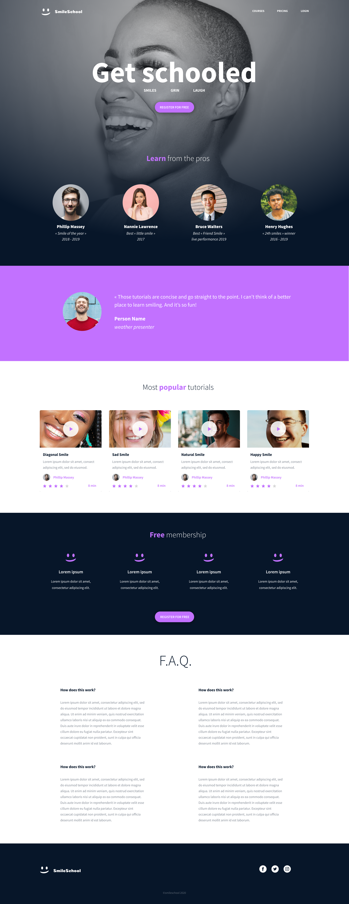

# HTML Advanced

## Description

This project is the first step in building a webpage from scratch from a designer file on Figma. It focuses on the **HTML structure only**: semantic HTML, with no CSS and no styling. The goal is to build a clean, well-organized page that later projects will style to match the design.

## Design

The design file is available on Figma. Some values in it are floats, so they are rounded when used.

## Learning Objectives

By the end of this project, I should be able to explain, without help from Google:

- What semantic HTML is and why it matters
- How to structure a page with tags like `<header>`, `<main>`, `<article>`, `<aside>` and `<footer>`
- How to read a designer file and turn it into an HTML structure

## Requirements

- All files end with a new line
- No external libraries or frameworks, only HTML, CSS and JavaScript
- Code is W3C compliant and validates with the W3C Validator
- A `README.md` at the root of the project folder

## Technologies

- HTML5

## How to View

Open `index.html` in any modern browser.

## Author

Keza Kethia, African Leadership University